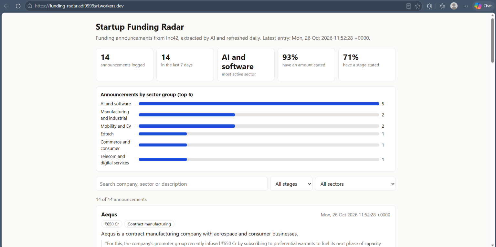
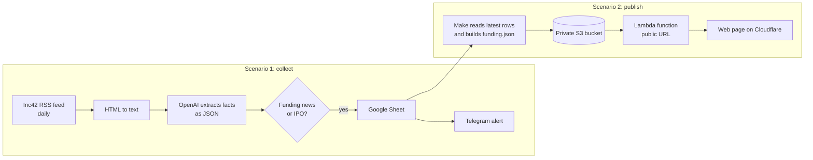
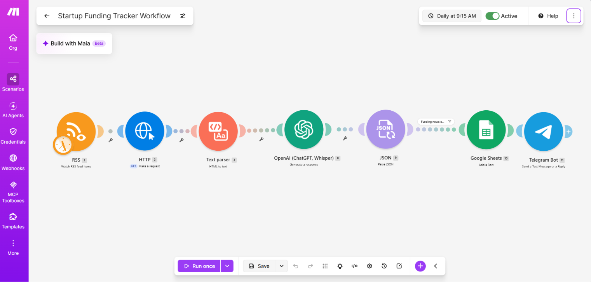
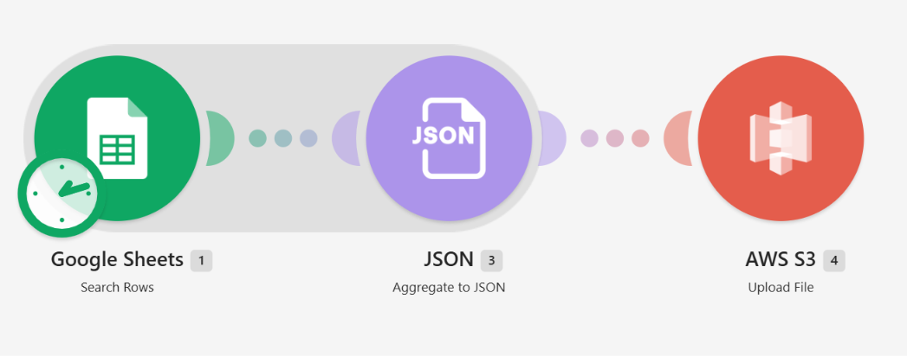
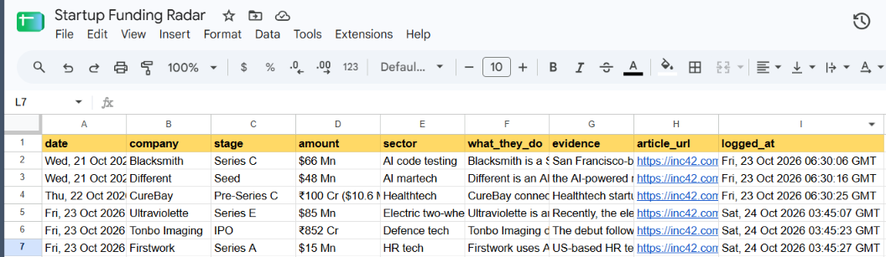

# Startup Funding Radar

**Live page: https://funding-radar.adi9999sri.workers.dev/**

An automated pipeline that reads Indian startup news every day, picks out funding announcements and IPOs, logs them in a Google Sheet, sends each one to me on Telegram, and publishes the latest list as a searchable web page.

**Problem:** Funding news is scattered across many articles, and most articles are not about funding. I wanted a daily, structured list of who raised what, without reading every headline.

**Status:** Live and running on a daily schedule. This is a first version built by one person, with no engineering background, using no-code tools and a small amount of cloud setup.

## How it works

**Scenario 1: collect (Make.com)**

1. Reads the Inc42 RSS feed once a day.
2. Converts the article description from HTML to plain text.
3. An OpenAI model (`gpt-5.4-mini`) returns a JSON object: whether it is funding news, company, stage, amount, sector, what the company does, and one sentence of evidence copied from the article.
4. Only items judged to be funding news continue.
5. A row is added to a Google Sheet, and a Telegram message is sent.

**Scenario 2: publish (Make.com + AWS + Cloudflare)**

1. Make reads the latest rows from the Sheet and writes them as one file, `funding.json`, into a private AWS S3 bucket.
2. An AWS Lambda function reads that file and returns it from a public URL. The bucket itself is never public.
3. A static page hosted on Cloudflare fetches that URL and shows the list, search, filters and summary metrics.

## What the page shows

- Announcements logged and how many fall in the last 7 days.
- The most active sector group, or "No clear leader" when the top groups are tied.
- Share of rows where an amount and a stage were stated.
- A search box and filters for stage and sector. IPOs appear as their own stage, so they can be filtered in or out.
- A link to the original article on every row.

The two percentages measure how often the AI **found** a value in the text. They do **not** measure whether the value is correct.

## Design decisions

**The AI only extracts facts.** It reads one article and fills a fixed set of fields. The rules in [`prompt.txt`](prompt.txt):
- Use only the text provided.
- If something is not stated, return `null`. Never guess.
- Include an `evidence` sentence copied from the article, so every row can be checked against its source.
- Return only the JSON object, so the next step can parse it reliably.

A wrong guess in a funding log is worse than a blank field. A `null` is visible and honest. A confident wrong number is not.

**Least privilege on AWS.** The IAM user that Make uses can write exactly one file (`funding.json`) in one bucket and nothing else. The Lambda can read exactly that one file. The bucket stays private. The Lambda URL serves only public news data.

**IPOs are tracked on purpose.** They are a way startups raise money, and Inc42 covers them as funding news. They show as their own stage so visitors can filter them.

**Sectors are grouped on the page.** The AI writes sectors as free text, so almost every row is unique. The page groups them into broad buckets so the chart and the "most active" card mean something.

## What went wrong while building (and how I fixed it)
- **Wrong input to the AI:** my first attempt passed the whole web page (roughly 600,000 characters of mostly page code) to the model. I switched to the RSS title and description, which are short and clean.
- **Date errors:** a hand-typed date formula returned "Invalid format". I used Make's Functions tab instead, and learned that Google Sheets reformats text that looks like a date.
- **Telegram 404:** I had left angle brackets around the bot token in the URL. Removing them fixed it. I also revoked and replaced the token afterwards because it had appeared in a screenshot.
- **Second source:** I tried adding a second feed, but it returned nothing or errors. One source was enough for a first version.
- **Region mismatch on AWS:** my free plan was locked to the Sydney region, and Make was set to a different one. Setting the same region everywhere fixed it.
- **Make couldn't list buckets:** my write-only IAM user was deliberately not allowed to list buckets, so the dropdown failed. I typed the bucket name instead of widening the permission.
- **A tie shown as a winner:** the "most active sector" card showed whichever sector came first when every sector had one item. I grouped sectors and added a "No clear leader" state.

## Quality checks
When I reviewed the first 11 logged rows against the articles, I found:
- **A duplicate:** the same company appeared twice (from two sources), so I removed one by hand.
- **A garbled evidence quote:** one row's "evidence" was a pasted table of text instead of a sentence.
- **A mislabeled row:** one row showed an earlier funding round from an article about a market debut.

I have **not yet measured accuracy on a larger sample**, so please treat the extraction as a first version and check the source link before relying on any figure.

## Limits
- **One source:** funding stories that Inc42 does not cover are missed.
- **Short text:** the RSS description is a summary, so some details can come back `null`.
- **No automatic duplicate check yet:** the same story could be logged twice. The page hides repeats of the same company and stage, but the Sheet can still hold them.
- **Free-text sectors and some mislabels:** the AI can mislabel a stage or amount. The `evidence` sentence is there for spot checks.
- **Daily refresh:** the page can be up to a day behind the news, plus a few minutes of caching.
- **Manual cleanup:** I removed some duplicate rows from the Sheet by hand.

## What I would improve next
- Add a duplicate check before logging (search the Sheet for the article link).
- Choose sector from a fixed list inside the prompt, so groups are consistent at the source.
- Fetch the full article text instead of the RSS summary.
- Build a small labeled test set of articles and track extraction accuracy over time.
- Add a second source and compare coverage.
- Add visitor analytics, and talk to a few founders and growth people about what they want from the alerts before adding features.

## Files
- [`prompt.txt`](prompt.txt): the extraction prompt.
- [`site/index.html`](site/index.html): the web page (it reads from a public Lambda URL, which is not included here).
- [`aws/lambda_function.py`](aws/lambda_function.py): the Lambda function (bucket name replaced with a placeholder).
- [`aws/`](aws): the two minimal IAM policies (bucket name replaced with a placeholder).
- [`make/Startup_Funding_Tracker_Workflow.REDACTED.blueprint.json`](make/Startup_Funding_Tracker_Workflow.REDACTED.blueprint.json): the Make.com collect scenario, with IDs and personal details removed. It is for reading, not for direct import.
- Screenshots at the top level: both Make scenarios, the Google Sheet, a Telegram alert and the live page.

## Tools
Make.com, OpenAI API, Google Sheets, Telegram Bot API, AWS (S3, IAM, Lambda), Cloudflare.
