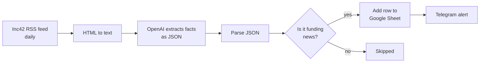

# Startup Funding Radar

An automated workflow that reads Indian startup news every day, picks out the funding announcements, logs them in a Google Sheet, and sends each one to me on Telegram.

**Problem:** Funding news is scattered across many articles, and most articles are not about funding. I wanted a daily, structured list of who raised what, without reading every headline.

**Status:** Live and running on a daily schedule. Built with no code, using Make.com and the OpenAI API.

## How it works

1. **Read:** Make.com watches the [Inc42](https://inc42.com/feed/) RSS feed once a day (up to 9 articles per run).
2. **Clean:** The article description is converted from HTML to plain text.
3. **Extract:** An OpenAI model (`gpt-5.4-mini`) reads the title and text and returns a JSON object: whether it is funding news, company, stage, amount, sector, what the company does, and one sentence of evidence copied from the article.
4. **Parse:** The JSON is split into separate fields.
5. **Filter:** Only articles where `is_funding_news` is true continue.
6. **Log:** A row is added to a Google Sheet with date, company, stage, amount, sector, description, evidence, article link, time logged and source.
7. **Alert:** A Telegram message arrives in this format: `New funding: Company (Stage, Amount). What they do. Link`

## Design decision: the AI only extracts facts

The model does not decide what is important or what to send. It reads one article and fills a fixed set of fields. The rules in the [prompt](prompt.txt) are:

- Use only the text provided.
- If something is not stated, return `null`. Never guess.
- Include an `evidence` sentence copied from the article, so every row can be checked against its source.
- Return only the JSON object, so the next step can parse it reliably.

I chose this because a wrong guess in a funding log is worse than a blank field. A `null` is visible and honest. A confident wrong number is not.

## What went wrong while building (and how I fixed it)

- **Wrong input to the AI:** My first attempt passed the full web page into the prompt, which was roughly 600,000 characters of mostly page code. I switched to the RSS title and description, which are short and clean.
- **Date errors:** A hand-typed date formula in Make returned "Invalid format." I used the Functions tab to insert the formula instead, and learned that Google Sheets reformats text that looks like a date.
- **Telegram 404:** I had left angle brackets around the bot token in the URL. Removing them fixed it. I also revoked and replaced the token afterwards, because it had appeared in a screenshot.
- **Second source:** I tried adding a second feed, but it returned nothing or errors. One source turned out to be enough for a first version.

## Quality checks

While building, I compared the model's output with the source article for several articles and confirmed the fields and evidence sentence matched. **I have not yet measured accuracy on a larger sample.** This is a small personal project, so please treat the extraction as a first version, not a verified data source.

## Limits

- **One source.** Funding stories Inc42 doesn't cover are missed.
- **Short text.** The RSS description is a summary, so some details (amount, stage) can come back `null`.
- **No duplicate check in this version.** A story that appears twice could be logged twice.
- **No formal accuracy measurement yet,** as stated above.
- **Model dependence.** Changes in article wording can cause extraction errors, which is why each row keeps its evidence sentence.

## What I would improve next

- Add a duplicate check before logging (search the Sheet for the article link).
- Fetch the full article text instead of the RSS summary.
- Build a small labeled test set of articles and track extraction accuracy over time.
- Add a second source and compare coverage.
- Talk to a few founders and growth people about what they actually want from the alerts before adding features.

## Files

- [`prompt.txt`](prompt.txt): the extraction prompt.
- `Startup_Funding_Tracker_Workflow.REDACTED.blueprint.json`: the Make.com scenario export, with IDs and personal details removed. It is for reading, not for direct import.

## Tools

Make.com, OpenAI API, Google Sheets, Telegram Bot API.
